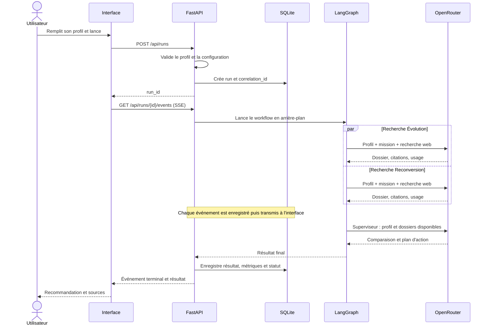

# Cap Avenir — plan de référence du TP

## Objectif et périmètre
Application locale en français : comparer une évolution professionnelle à une reconversion avec deux agents de recherche et un superviseur LangGraph. Deux vues : Mon orientation et Supervision. Durée cible de réalisation : 90 minutes, sous réserve de disponibilité de l'API et des dépendances.

## Parcours utilisateur
1. Ouvrir l'application : formulaire immédiatement visible, bouton « Remplir un exemple ».
2. Renseigner situation actuelle, compétences, objectif, marché ciblé, temps disponible et horizon.
3. Cliquer « Explorer mes possibilités ». Valider les champs avant tout appel payant.
4. Afficher le workflow en perspective, les événements et les durées. Désactiver les doubles lancements.
5. Recevoir la recommandation, les deux trajectoires, les sources et un plan 30/60/90 jours.
6. Consulter les dossiers des agents ou télécharger le rapport JSON.
7. Ouvrir Supervision : historique, métriques, alertes, détails et replay.
8. « Modifier mon profil » conserve les champs saisis et permet une nouvelle exécution.

## Champs
- Situation actuelle : texte obligatoire (ex. étudiant, développeur junior).
- Compétences : texte obligatoire.
- Objectif : évoluer / me reconvertir / comparer les deux (par défaut).
- Marché ciblé : texte, Maroc par défaut ; option remote.
- Temps disponible : nombre d'heures par semaine, 8 par défaut.
- Horizon : 3 / 6 / 12 mois, 6 par défaut.
- Centres d'intérêt et contraintes : texte facultatif.
Afficher les erreurs sous les champs. Ne pas demander de nom ni de compte.

## Agents
Évolution et Reconversion reçoivent le même profil et travaillent en parallèle. Évolution étudie une spécialisation du domaine actuel ; Reconversion explore deux domaines proches et retient une piste. Le superviseur compare leurs dossiers en fonction du profil, des contraintes, de l'effort et des éléments sourcés. Il peut recommander l'une des voies, une combinaison ou une exploration complémentaire.

Les agents partagent des dossiers structurés ; il ne s'agit pas d'un débat à plusieurs tours. Les recherches doivent être contextualisées par marché et date. Les opportunités sont des exemples sourcés, sans prétendre à un recensement exhaustif. Aucun pourcentage de réussite inventé.

## Séquence

## Interface
Navigation persistante : Mon orientation / Supervision. Vue orientation : profil à gauche, scène de workflow au centre ; résultats sous la scène. Sur petit écran, empiler les panneaux.

Perspective CSS et connexions SVG : profil, deux stations de recherche, superviseur, résultat. Les états sont attente, actif, terminé, erreur. Le temps avance pendant l'appel ; tokens et coût restent indisponibles tant que l'API ne les a pas fournis. La durée réseau, la recherche et la génération sont regroupées dans la durée de l'appel si aucun événement plus précis n'est exposé.

Chaque station est cliquable : dossier, sources, événements et métriques. Les particules représentent uniquement des transmissions réellement enregistrées. Chronologie par agent avec chevauchement des recherches. Replay x1/x2/x4 depuis les événements persistés, sans nouvel appel API et sans nouveaux frais.

Supervision : nombre d'exécutions, durée moyenne, taux de réussite, coût connu cumulé ; comparaison par agent ; historique filtrable par statut ; détails d'une exécution ; alertes ; exports CSV et JSON. Simulateur 10/100/1000 exécutions basé sur les coûts connus des exécutions réussies, échantillon affiché. Mode démonstration séparé des métriques réelles.

## Architecture
Un processus FastAPI sert l'interface statique et les routes API. LangGraph orchestre les agents. SDK OpenAI configuré avec l'URL OpenRouter. SQLite conserve les exécutions, étapes, événements et alertes. Une tâche en arrière-plan exécute le graphe ; SSE transporte les événements et permet de récupérer les événements manqués depuis un identifiant. Un rafraîchissement restaure une exécution en cours. Projet local, sans authentification ni déploiement à réaliser dans le TP.

Routes : POST /api/runs ; GET /api/runs ; GET /api/runs/{id} ; GET /api/runs/{id}/events ; GET /api/metrics ; GET /api/exports/runs.csv ; GET /api/runs/{id}/export ; GET /api/workflow/export.

Événement : event_id, correlation_id, step_id, agent, type, timestamp UTC, elapsed_ms et payload. Types : run_started, agent_started, agent_completed, agent_failed, handoff, alert, run_completed, run_failed. Utiliser une horloge monotone pour les durées ; afficher les dates dans le fuseau utilisateur.

## Stockage et coûts
Tables runs, steps, events, alerts. run_id sert de correlation_id. Le profil et le résultat sont des colonnes JSON. Chaque agent dispose de son propre step_id. Les branches écrivent dans des clés d'état distinctes pour éviter les conflits LangGraph.

Enregistrer prompt_tokens, completion_tokens, total_tokens et usage.cost retournés par OpenRouter. Un coût absent est inconnu, jamais zéro. Identifier les calculs de secours comme estimations ; éviter de compter deux fois les frais de recherche déjà inclus. Un dépassement de budget est une alerte au constat, pas une garantie de blocage avant facturation.

## Alertes et erreurs
Trois alertes configurables : lenteur d'étape (exemple 45 s), coût connu dépassant le seuil (exemple 0,10 USD), erreur d'agent. Les seuils sont des choix de démo, à ajuster après le premier essai.

Clé absente : message avant lancement. Erreur fournisseur : message lisible et détail technique dans les logs sans clé. Délai maximal par appel : 90 s. Si une recherche échoue, le superviseur utilise le dossier disponible et signale le résultat partiel. Si les deux échouent, terminer en erreur sans lancer le superviseur. Si le superviseur échoue, conserver les deux dossiers. Pas de relance payante automatique ; le bouton Réessayer lance une nouvelle exécution liée à la précédente.

Une coupure SSE ne relance pas les agents. Un redémarrage serveur marque les anciennes exécutions actives comme interrompues. Le mode démonstration est explicite et ne déclenche pas d'appel payant. Les rapports sans citations sont signalés comme non vérifiés.

## Fichiers prévus
app.py, workflow.py, provider.py, storage.py, requirements.txt, .env.example, .gitignore, README.md, static/index.html, static/app.js, static/style.css. Base SQLite créée au lancement dans data/. Aucun secret dans le frontend ou les exports.

## Plan 90 minutes
0–10 : environnement et appel OpenRouter avec recherche, citations et usage. Valider le modèle compatible avant de développer l'interface.
10–35 : agents, exécution parallèle, enregistrement et événements.
35–60 : formulaire, workflow en perspective et résultats.
60–75 : supervision, alertes, exports et replay.
75–85 : vérifications complètes et scénarios d'erreur.
85–90 : documentation et répétition de démonstration.

Si le temps manque : supprimer le sélecteur de vitesse et les animations secondaires avant de réduire les livrables de supervision. Priorités : graphe réel, traces corrélées, métriques fiables, trois alertes et exports.

## Vérifications de livraison
- Un profil valide produit deux dossiers et une synthèse ; un profil invalide ne déclenche pas d'appel.
- Les recherches sont parallèles et le superviseur attend leur fin.
- L'historique survit au redémarrage et les métriques se rapportent aux bonnes exécutions.
- Les erreurs, coûts inconnus et résultats partiels sont visibles.
- Le replay ne fait aucun appel LLM et respecte les durées enregistrées.
- Les trois alertes sont reproductibles en démonstration clairement identifiée.
- Les exports workflow JSON, exécutions CSV et rapport JSON fonctionnent.
- La clé API n'apparaît dans aucun écran, export ou log.

## Configuration à valider au début du développement
OPENROUTER_API_KEY, OPENROUTER_MODEL, seuils et timeouts via .env. Utiliser une nouvelle clé saisie localement. Le modèle OpenAI et le moteur de recherche sont configurables et doivent réussir le premier essai réel. La documentation OpenRouter indique que les server tools de recherche sont en bêta : https://openrouter.ai/docs/guides/features/server-tools/web-search . Comptabilisation : https://openrouter.ai/docs/cookbook/administration/usage-accounting .
