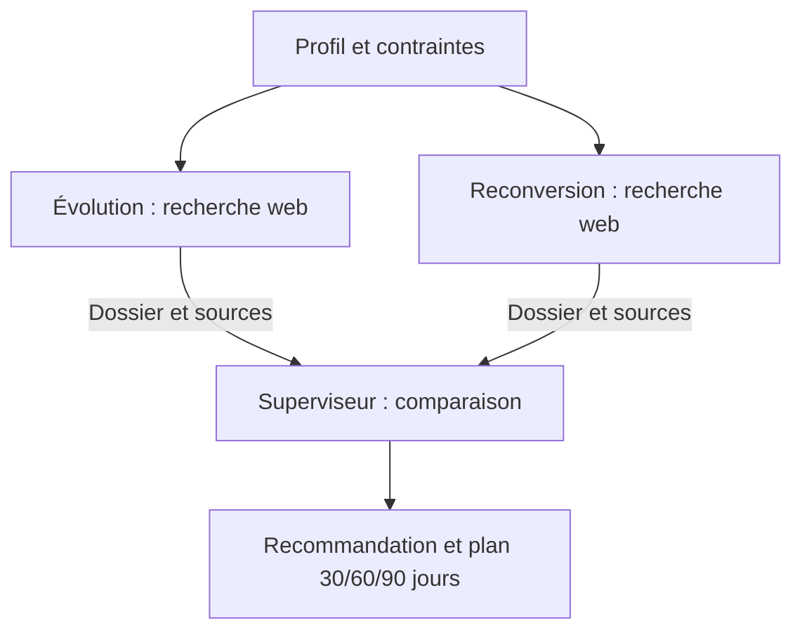

# Cap Avenir

Plateforme locale d'orientation professionnelle avec trois agents LangGraph, recherche web réelle, workflow animé en perspective et dashboard de supervision.

## Exploitation, Docker et gestion des versions

Le plan détaillé est dans INTEGRATION-EXPLOITATION.md. Docker Desktop doit être démarré. Après la configuration initiale, **DOCKER.cmd** prépare les deux images de présentation et ouvre **http://127.0.0.1:8080/#operations**. L'installation initiale de la version stable est identifiée comme bootstrap, sans être présentée comme une revue humaine.

L'onglet **Exploitation** affiche la version et propose : arrêt d'urgence persistant, reprise explicite, incidents simulés en mode démo uniquement, approbation/refus des images candidates et journal exportable. Entrer son nom avant une intervention. Le nom est déclaratif pour le TP local ; il ne remplace pas une authentification de production.

Une nouvelle version doit être approuvée dans cet onglet avant **DEPLOYER.cmd**. Le gestionnaire vérifie l'ID exact de l'image, active la pause, sauvegarde SQLite, remplace le conteneur et contrôle sa disponibilité. **ROLLBACK.cmd** revient à l'image précédente et conserve la pause et les données ; réautoriser les analyses après vérification. Le conteneur n'a pas accès au socket Docker : seules les commandes exécutées sur l'hôte gèrent son remplacement.

**EXERCICE.cmd** teste ces procédures dans des conteneurs et dossiers temporaires, sans clé API. L'approbation de cet exercice est simulée et explicitement identifiée comme telle. Le rapport est livrables/exercice-docker.json. Procédure de présentation et d'urgence : livrables/RUNBOOK.md ; fiche des agents : livrables/AGENT_CARD.md.

Images de présentation : `cap-avenir:1.1.0` stable et `cap-avenir:1.1.1-incident.1` avec panne forcée en démonstration. La deuxième image sert uniquement à l'exercice. Les données et le registre de versions sont montés depuis data/ et runtime/ et ne sont pas intégrés à l'image. L'exposition réseau reste sur l'adresse locale.

La CI exécute aussi l'exercice Docker avant la livraison de l'archive. Le workflow **Publication approuvee**, lancé manuellement dans GitHub Actions, vérifie l'environnement protégé `production`, teste une image et attend l'approbation humaine avant de publier exactement cette image dans GHCR. La protection requise est contrôlée : la publication est refusée si aucun approbateur obligatoire n'est configuré. Le déploiement sur la machine reste une action locale explicite.

## CI et livraison automatisee

La pipeline `.github/workflows/ci.yml` verifie les dependances, la syntaxe Python/JavaScript et les tests sans appel API. Si les controles passent, elle cree une archive telechargeable du code et du graphe LangGraph. Elle est reliee au depot [hamza-ouchen/coachcar](https://github.com/hamza-ouchen/coachcar) et se declenche a chaque push ou pull request. Les executions sont visibles dans [GitHub Actions](https://github.com/hamza-ouchen/coachcar/actions). Aucun deploiement d'hebergement n'est configure.

Pour executer les memes controles localement sans coder : double-cliquer **VERIFIER.cmd**. L'archive est creee dans `ci-output/Cap-Avenir-CI.zip`. Le fonctionnement de l'application et ses donnees restent inchanges. Le guide **livrables/CI-CD.md** explique les etapes et leur presentation au professeur.

## Lancer sans coder

Sous Windows, double-cliquer sur **LANCER.cmd**. L'application s'ouvre à **http://127.0.0.1:8000**. Le lanceur réutilise un serveur Cap Avenir déjà démarré ; sinon il le lance. Garder sa fenêtre ouverte pendant l'utilisation.

La configuration locale est déjà réalisée sur la machine de développement. Sur une autre machine : Python 3.12 ou ultérieur, Internet pour installer les dépendances ; le lanceur demande la clé OpenRouter si `.env` est absent. L'entrée de la clé est masquée. La clé reste côté serveur et n'est pas livrée dans l'archive.

Lancement manuel facultatif :

```powershell
.\.venv\Scripts\python.exe -m uvicorn app:app --host 127.0.0.1 --port 8000
```

## Parcours utilisateur

1. Cliquer **Un exemple**, ou renseigner situation, compétences et contraintes.
2. Choisir **Analyse réelle** ou **Démonstration**.
3. Cliquer **Explorer mes possibilités**.
4. Observer les agents et la chronologie. Cliquer une station pour consulter son dossier.
5. Lire la recommandation, la comparaison et les étapes à 30/60/90 jours.
6. Cliquer **Rejouer** pour revoir les événements sans nouvel appel payant.
7. Ouvrir **Supervision** pour les performances, alertes et exports.

Les démonstrations utilisent des contenus et coûts simulés explicitement signalés, sans appel LLM ni recherche réelle. Leurs métriques sont séparées des analyses réelles.

## Les agents



- **Évolution** : spécialisation dans le domaine actuel, compétences et opportunités.
- **Reconversion** : exploration de deux domaines voisins et sélection d'une piste accessible.
- **Superviseur** : compare les deux dossiers en tenant compte des objectifs, du marché et du temps disponible. Il ne refait pas de recherche.

LangGraph réalise réellement les deux branches en parallèle, puis attend les deux résultats avant de lancer le superviseur. Les agents communiquent par des dossiers dans l'état partagé. Il n'y a pas de débat à plusieurs tours.

Les pages trouvées et exemples d'offres sont des éléments de recherche, sans garantie de disponibilité ou d'emploi. Les rapports exposent les incertitudes. Les citations confirmées par les métadonnées de recherche sont distinguées des sources simplement proposées par le modèle.

## Architecture

```text
Navigateur (HTML / CSS / JavaScript)
             ↕ HTTP + Server-Sent Events
FastAPI → LangGraph → OpenRouter → modèle OpenAI / recherche web
   ↕
SQLite : runs, steps, events, alerts
```

Un serveur, une base locale, aucune infrastructure supplémentaire. Le modèle configuré est `openai/gpt-4.1-mini`. Les recherches utilisent `openrouter:web_search` avec le moteur Exa via OpenRouter, deux recherches au maximum par agent et huit résultats au maximum par appel. Les server tools étant en bêta, leur disponibilité peut dépendre du compte et du fournisseur.

L'interface est une représentation en perspective CSS/SVG, avec effets de relief ; ce n'est pas une scène WebGL. Les animations reflètent les événements observés. La durée d'un appel inclut réseau, recherche et génération : l'application ne prétend pas mesurer séparément les phases internes non exposées par le fournisseur.

## Logs, métriques et coûts

- `correlation_id` = identifiant UUID de l'exécution, commun aux étapes et événements.
- `step_id` = identifiant d'un appel d'agent.
- Débuts/fins, statuts, erreurs, transmissions et alertes sont horodatés et persistés.
- Durées calculées avec une horloge monotone ; dates stockées en UTC et affichées dans le fuseau Africa/Casablanca.
- Tokens et coût enregistrés depuis `usage` d'OpenRouter, après réception de la réponse.
- Coût absent = inconnu ; une somme partielle est identifiée et ne sert pas aux projections.
- Coût cumulé : somme des coûts retournés, sans ajout séparé des frais de recherche pour éviter de les compter deux fois.
- Projections : moyenne des coûts complets des exécutions réussies × 10, 100 ou 1 000 ; échantillon affiché.
- Le taux de réussite compte les missions complètes parmi les missions terminées. Les résultats partiels ne sont pas comptés comme réussites complètes.

## Trois alertes documentées

Voir **livrables/ALERTES.md** pour les seuils, déclencheurs et scénario de démonstration. Les alertes sont visibles dans la mission et le dashboard, sans notification externe.

## Reprise et erreurs

Actualiser la page retrouve la mission sélectionnée et ses événements. Une reconnexion SSE reprend après le dernier événement connu sans relancer d'appel. Un arrêt du serveur interrompt les tâches actives : elles sont marquées interrompues au redémarrage, tandis que l'historique est conservé.

Une recherche échouée donne un résultat partiel si l'autre dossier est disponible. Deux recherches échouées annulent la synthèse. Les dossiers restent consultables si le superviseur échoue. Chaque appel a un délai maximal de 90 secondes et aucun retry payant automatique. Un budget dépassé déclenche une alerte constatée, pas un plafond de facturation garanti.

## Livrables

- `livrables/workflow.json` : export du graphe réel LangGraph, configuration et alertes.
- `livrables/executions.csv` : table exportée avec correlation_id.
- `livrables/exemple-analyse-reelle.json` : rapport, événements et usage d'un essai réel.
- `livrables/ALERTES.md` : trois alertes documentées.
- `livrables/PRESENTATION.md` : déroulé de démonstration.
- `PLAN.md` : plan UX et diagramme de séquence.
- Exports actualisés disponibles dans l'application et via `/api/workflow/export`, `/api/exports/runs.csv`, `/api/runs/{id}/export`.

L'export JSON du workflow décrit le graphe et ses paramètres. Il ne constitue pas un format universel d'import automatique ; le workflow exécutable est `workflow.py`.

## Vérifications

Tests d'intégration hors ligne :

```powershell
.\.venv\Scripts\python.exe -m unittest discover -s tests -v
```

Ils vérifient le parallélisme, la synchronisation du superviseur, les coûts connus/inconnus, les résultats partiels, les trois alertes, les validations API, les exports et la conservation de l'historique.

Tests navigateur facultatifs : `browser_check.py` utilise Playwright et Chrome, avec un serveur déjà démarré. Installation de l'outil : `python -m pip install playwright`. Captures dans `artifacts/`. `check_provider.py` et `live_check.py` déclenchent de vrais appels facturés ; ils ne sont pas nécessaires au lancement.

## Configuration

`.env` (non versionné) : clé OpenRouter, modèle, `SLOW_STEP_SECONDS=45`, `BUDGET_ALERT_USD=0.10`, `STEP_TIMEOUT_SECONDS=90`. Redémarrer le serveur après modification. `.env.example` donne le format sans secret. SQLite se trouve dans `data/cap_avenir.db`.

Documentation fournisseur :
- https://openrouter.ai/docs/guides/features/server-tools/web-search
- https://openrouter.ai/docs/cookbook/administration/usage-accounting
- https://docs.langchain.com/oss/python/langgraph/streaming
