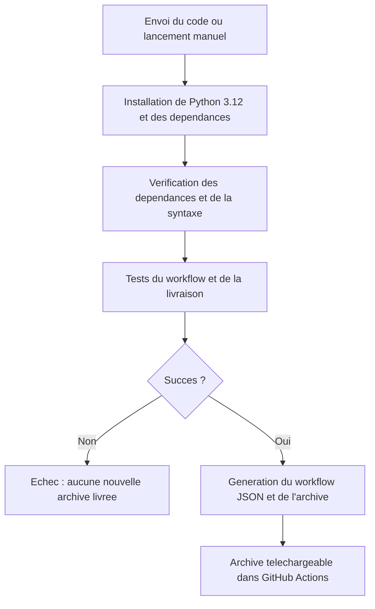

# Pipeline CI et livraison continue — Cap Avenir

## Ce qui est automatise

La configuration est `.github/workflows/ci.yml`. Une fois le projet envoye dans un depot GitHub avec Actions active, elle se declenche sur chaque push, chaque pull request et par lancement manuel depuis Actions.

Le premier job `tests` controle le programme. Le second job `delivery` contient `needs: tests` : il est execute seulement apres la reussite du premier. Les erreurs arretent normalement les etapes suivantes. Les archives d'anciens runs restent independantes d'un nouveau run en echec.

## Ce que les tests verifient

- Les recherches sont paralleles et le superviseur attend les deux dossiers.
- Les evenements partagent le bon correlation_id.
- Les tokens et couts connus sont correctement additionnes.
- Les erreurs produisent des resultats partiels ou un echec selon les dossiers disponibles.
- Les trois alertes se declenchent.
- Les routes, validations et exports fonctionnent.
- L'historique survit au redemarrage.
- L'archive peut etre produite sans lire la base locale ni appeler le fournisseur.

Ces tests utilisent des reponses simulees. Ils ne mesurent pas la qualite semantique d'une vraie recommandation et ne prouvent pas la disponibilite actuelle du fournisseur. Les scripts check_provider.py et live_check.py restent des verifications reelles facultatives, distinctes et facturees lorsqu'on les lance. Ils ne sont pas executes par cette pipeline.

## Artefact livre

`ci-output/Cap-Avenir-CI.zip` contient le code, l'interface, les tests, les workflows, la documentation, un exemple de configuration sans cle et le graphe LangGraph exporte. `manifest.json` indique la revision GitHub et les fichiers embarques.

La creation de cette archive ne depend pas de `data/`, de `.env`, des resultats d'une ancienne analyse ni de prepare_delivery.py. Le script historique prepare_delivery.py conserve son usage pour les livrables locaux du TP ; scripts/package_ci.py s'occupe des livraisons automatiques. Aucune dependance de l'application n'est reecrite pendant la pipeline.

La cle, la base SQLite, l'environnement virtuel et les anciens exports d'analyses sont exclus. Aucune cle OpenRouter n'est necessaire dans GitHub pour cette CI.

## Activation sur GitHub

Le projet est relie au depot [hamza-ouchen/coachcar](https://github.com/hamza-ouchen/coachcar), avec la branche locale `main` suivant `origin/main`. L'adresse SSH est `git@github.com:hamza-ouchen/coachcar.git`. Les executions sont accessibles dans [GitHub Actions](https://github.com/hamza-ouchen/coachcar/actions).

1. Envoyer une modification dans le depot : le push declenche automatiquement la pipeline. Les exclusions de .gitignore conservent la cle et les donnees locales sur l'ordinateur.
2. Ouvrir l'onglet Actions du depot.
3. Choisir **Cap Avenir - Tests et livraison**.
4. Ouvrir l'execution lancee par le push, ou cliquer Run workflow pour un lancement manuel.
5. Apres reussite, telecharger `cap-avenir-<revision>` dans Artifacts. Il contient l'archive du projet et son manifeste. Conservation configuree : 14 jours, dans les limites des regles du depot.

## Verifier localement sans coder

Double-cliquer **VERIFIER.cmd**. Le lanceur utilise l'environnement existant et Node.js pour verifier le JavaScript ; il execute les memes controles et cree l'archive CI. Il n'installe rien et ne modifie pas l'application ou ses donnees.

## Comment l'expliquer au professeur

« Nous avons ajoute une integration continue qui teste automatiquement le workflow des agents a chaque modification envoyee sur GitHub. Les reponses du fournisseur sont simulees pour avoir des tests reproductibles sans cout API. Si tous les controles passent, un second job prepare une archive liee a la revision testee. Nous faisons une livraison d'artefact ; le deploiement sur un serveur d'hebergement n'est pas configure. »

Il faut distinguer le workflow LangGraph, qui execute une orientation, du workflow GitHub Actions, qui verifie et livre le logiciel.

References officielles : https://docs.github.com/en/actions/tutorials/build-and-test-code/python et https://github.com/actions/upload-artifact .
